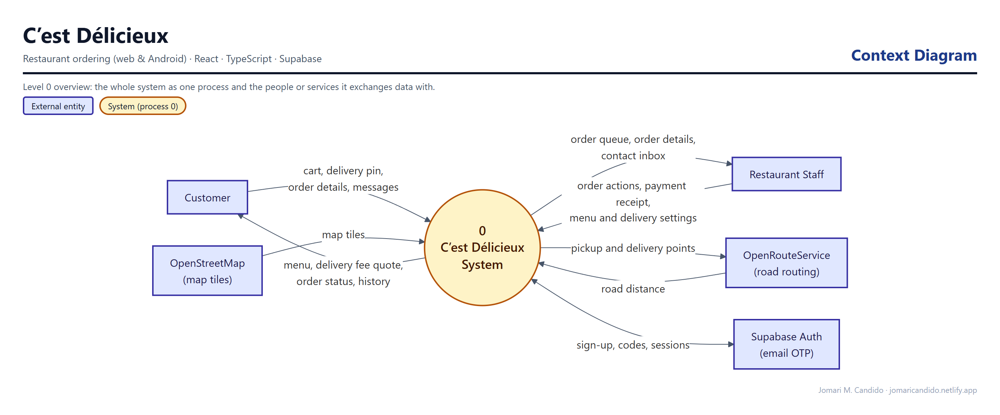
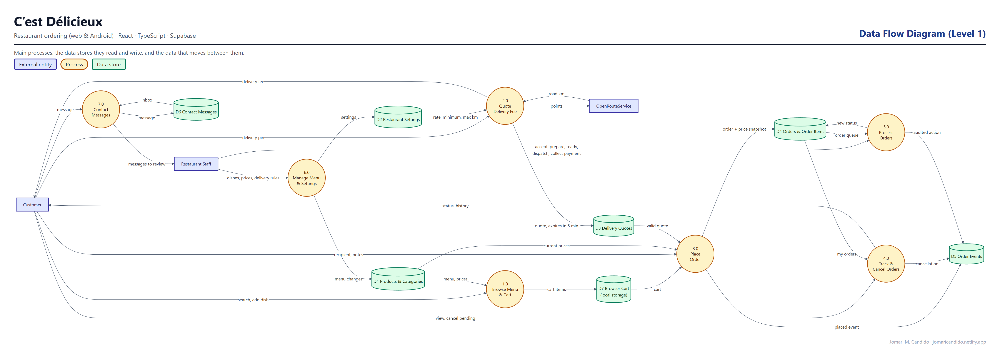
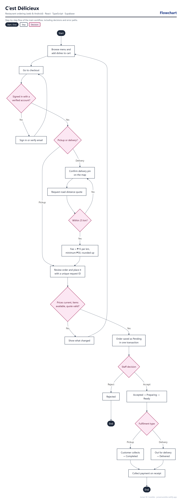

# C’est Délicieux

**Restaurant Ordering System (Web & Android)**

C’est Délicieux is a restaurant ordering app with a 25-dish menu, a persistent cart, pickup or delivery with road-distance fees, and pay-on-receipt orders. Restaurant staff manage orders, the menu, delivery pricing, and customer messages from a separate workspace. It runs on the web and as an Android app.

## Live Demo

**[Open C’est Délicieux](https://cestdelicieux.netlify.app/)**

## Highlights

- 25 original menu dishes in five categories, with search and a persistent cart
- Registration, email verification and code resend, sign-in, and profile
- Pickup or delivery: confirm a map pin, then get a road-distance quote (₱15/km, ₱50 minimum, up to 25 km)
- Transactional order placement with current prices, price snapshots, and safe retries
- Order history, live status, and cancellation while pending
- Staff workspace for order progress, payment collection, menu editing, delivery settings, and the contact inbox
- Android app built with Capacitor, with safe-area, Back button, and offline handling
- Responsive navigation, 44 px controls, keyboard dialogs, and reduced motion

## System design

These diagrams were drawn from the app's actual database schema, roles and code paths.

**Context diagram.** C’est Délicieux as a single process, and the people and outside services it exchanges data with.



**Data flow diagram (Level 1).** The main processes, the data stores they read and write (grouped from the database tables), and the data that moves between them.



**Flowchart: checkout and order lifecycle.** The main workflow step by step, including decisions and error paths.



## Tech Stack

- React, TypeScript, Vite, React Router
- Supabase Auth, PostgreSQL, Row Level Security, RPC functions, and Edge Functions
- OpenRouteService for road distance (called server-side)
- Leaflet with OpenStreetMap tiles
- Capacitor for Android
- Vitest
- Netlify

## Security Design

Staff membership is checked in the database, not in editable user metadata. Orders are placed in one transaction that re-checks prices and availability and records immutable snapshots; repeated requests with the same ID are safe. The `delivery-quote` Edge Function requires a signed-in user, keeps the routing key as a server secret, and is rate-limited. Private tables live in a separate schema that the public API cannot reach.

> Only the Supabase project URL and publishable key are bundled. A bundle check (`npm run check:bundle`) fails the build if a secret key, local path, or development server URL is found. Service-role keys and routing keys must never be committed to this repository.

## Database

SQL migrations are in [`supabase/migrations/`](supabase/migrations/), with seed data in `supabase/seed.sql` and the delivery function in `supabase/functions/delivery-quote/`. Setup guides: [Supabase setup](docs/supabase-setup.md), [delivery setup](docs/delivery-setup.md), [database contracts](docs/database-contracts.md), and [staff access](docs/staff-access.sql).

## Local Use

Use Node.js 24 or later.

```sh
npm ci
cp .env.example .env.local   # set the Supabase URL and publishable key
npm run dev
```

Open http://127.0.0.1:5180. `npm run build` creates `dist`.

## Android

App ID `com.jomaricandido.cestdelicieux`, Android 7.0 (API 24) and later. The app bundles `dist` and does not load a development server. See [Android setup](docs/android-setup.md).

## Testing

`npm test` runs 79 automated unit and Edge Function tests. `npm run test:db` runs real database tests against a disposable local PostgreSQL cluster, and `npm run test:browser` runs Playwright CLI regression checks. `npm run typecheck`, `npm run check:assets`, and `npm run check:bundle` complete the release checks. See the [audit](AUDIT.md) and [release checklist](docs/release-checklist.md).

## Author

**Jomari M. Candido**
Sole Software Developer

## Project Status

Portfolio release — live on Netlify and deployed from this repository. The pickup point is a demo location in Metro Manila; no real restaurant address is claimed.
